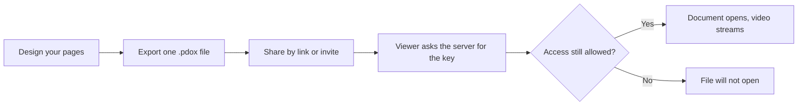

# pdox

**Documents with playable video.**

pdox is a visual document editor. Place text, images, tables, charts and video on a page, then export everything as one encrypted `.pdox` file: a real PDF with playable video exactly where you put it. You decide who can open it, and you can take that access back at any time.

[Website](https://pdox.app) | [Pricing](https://pdox.app/pricing) | [Contact](mailto:support@pdox.app)

---

## Why pdox

A normal PDF cannot play video, and once you email it, you have no say in who reads it or how long they can.

pdox fixes both:

- Video lives on the page, at the exact position and size you chose, at any zoom level.
- Every file is encrypted. The key never travels with the file, so the viewer asks the server for it on every open.
- Turn sharing off, and every file you ever exported stops opening.

---

## How it works



1. **Design.** Build pages in the editor with text, images, tables, charts, shapes and video. Start from 20+ templates or a blank page.
2. **Export.** Pages are rendered in headless Chromium, so the PDF inside is a genuine PDF, not an image.
3. **Share.** Send the file or a permanent link. Choose who can open it.
4. **Stay in control.** Every open is checked live. Revoke access and old copies stop working.

---

## Features

### Editor
- Text, images, tables, charts, shapes and video on one canvas
- Drag, resize, align, layers, multi-select, undo and redo, autosave
- 20+ starter templates: resumes, proposals, invoices, pitch decks, reports, flyers, certificates, planners and more
- Multi-page and landscape layouts

### Video
- Playable video placed exactly where you put it
- Videos are never stored inside the file. Only opaque ids travel with it, and playback streams from the server after an access check
- Pro and above can upload videos (transcoded server-side), pictures and audio into a vault and reuse them across documents
- Free plan supports public video URLs

### Sharing and control
- Four sharing modes: private, anyone with the link, invited by email, or a whole email domain
- Optional link protection: expiry date, passcode, and a faint watermark with the viewer's email
- "Always show the latest version" for files you keep updating
- Permanent viewer links that work without the file
- Team workspaces where members open the workspace's documents

### Analytics (Pro and above)
- See who opened a document, when, and how long each page was viewed
- Video views are tracked separately
- Optional email the first time someone opens a document

### Viewer
- Continuous scroll, zoom, page thumbnails, theatre mode, fullscreen and keyboard shortcuts
- Drop a file anywhere to open it
- Available in 10 languages: English, Hindi, Spanish, Portuguese (Brazil), French, German, Japanese, Chinese (Simplified), Arabic and Italian

---

## Security

pdox is built so that nothing worth protecting sits in the file or in the browser's storage.

| Layer | What it does |
|---|---|
| Encrypted PDF | `document.pdf` is AES-256-GCM ciphertext. GCM also detects any tampering |
| Server-held key | The key is encrypted at rest and released only after a live access check |
| Sealed metadata | Title, pages, video ids and settings are encrypted inside the file |
| Live revocation | Stop sharing, remove someone or delete the document and old files stop opening |
| Cookie sessions | HttpOnly session cookies with rotating refresh tokens. No tokens in local storage |
| Request hardening | CSRF checks, exact-origin CORS, rate limits and an SSRF guard on image fetching |
| Audit log | Every key fetch and stream pass is logged, without tokens or keys |

### What pdox does not do

We would rather be clear about the limits:

- Anyone with access can save the PDF. Decryption happens in the viewer's browser, so encryption stops people without access and lets you revoke. It is not DRM.
- Screen recording and screen capture cannot be prevented.
- The viewer watermark is a deterrent, not a security control.
- Files exported before encryption was introduced are unencrypted and cannot be revoked.

To report a vulnerability, see `SECURITY.md`.

---

## The `.pdox` format

A `.pdox` file is a standard zip:

```
document.pdf      the rendered pages, AES-256-GCM ciphertext
metadata.json     a tiny readable manifest
metadata.enc      title, pages, video ids, settings and checksum, encrypted with the same key
```

On open, the viewer requests the key, decrypts the PDF and metadata, verifies the id and the SHA-256 checksum, and only then renders. A modified file fails the check and does not open.

---

## Plans

| | Free | Pro | Team |
|---|---|---|---|
| Price | $0 | $12 / month | $49 / month |
| Saved documents | 3 | 50 | Unlimited |
| Exports per month | 20 | 500 | Unlimited |
| Video | Public URLs | URLs and uploads, private videos | URLs and uploads, private videos |
| Vault | - | 2 GB personal | 10 GB shared |
| Analytics | - | Yes | Yes |
| Workspaces | - | - | Up to 3, 25 members each |

See [pdox.app/pricing](https://pdox.app/pricing) for current details.

---

## Tech stack

| Area | Technology |
|---|---|
| Frontend | React 18, Vite, Tailwind, react-router 7, react-pdf, Web Crypto, i18next |
| Backend | Node.js 22, Express, Mongoose, Joi |
| Database | MongoDB |
| PDF rendering | Puppeteer (headless Chromium) |
| Media | ffmpeg transcoding, S3 storage, CloudFront signed URLs |
| Payments | Dodo Payments, Stripe for existing accounts |
| Hosting | Cloudflare (frontend), containerised backend |

---

## Repository layout

```
backend/     Express API, PDF export, encryption, billing, media streaming
frontend/    React app: editor, viewer, account and billing pages
docs/        API reference and migration notes
scripts/     Repository maintenance helpers
brand/       Brand assets for social profiles and print
```

Developer setup, environment variables, deployment and operations are documented in [`docs/DEVELOPMENT.md`](docs/DEVELOPMENT.md).

---

## Contributing

pdox is proprietary software and is not open to external contributions. Bug reports and feature requests are welcome at support@pdox.app.

---

## License

Copyright (c) pdox Inc. All rights reserved. The source may not be copied, modified or redistributed without written permission. Use of the hosted service is covered by the Terms of Service at [pdox.app/resources/terms](https://pdox.app/resources/terms).

Third-party open-source packages keep their own licences.

Sales and enterprise enquiries: support@pdox.app
